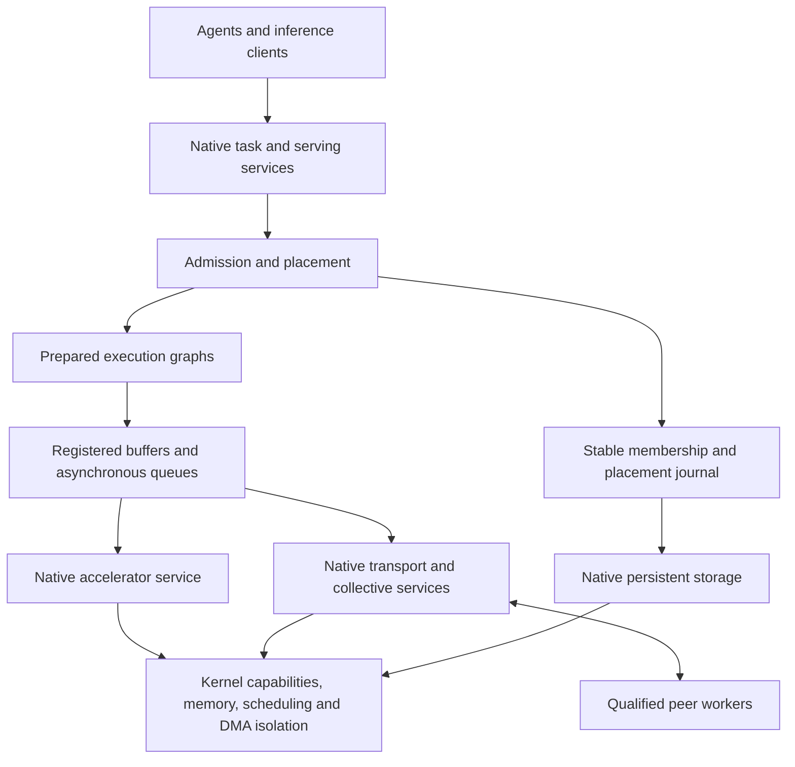

# Architecture

The privileged core owns address spaces, CPU scheduling, clocks, interrupt delivery, capabilities and DMA isolation. Native services implement storage, networking, accelerator execution, model serving and cluster coordination. Model parsing and placement algorithms do not require privileged execution.

## Local execution

The engine validates a model artifact, reserves weights/state/workspace, prepares operator and transfer graphs, and replays commands through persistent submission/completion queues. Each buffer has an owner, access permissions, registration lifetime and explicit completion ordering. Reuse reduces repeated allocation and mapping work; revocation and driver failure must not leave stale DMA access.

Kernel execution budgets and native serving policy account for tenant work. Bounded prefill chunks allow scheduling opportunities, while decode and cancellation receive defined budgets. The complete end-to-end latency target includes queues, nonpreemptible kernels, copies, encryption and network behavior; chunking alone proves no p99 bound.

## Distributed execution

Each node owns local resources. Workers authenticate, advertise measured capabilities and receive leases for qualified roles. Admission reserves every shard's memory and execution budget. The placement journal authorizes epochs, and accepted outputs carry the corresponding request and placement identity.

A stable three-node control group is the first quorum target. The laptop can execute a model shard without being a quorum member. Membership reconciliation and artifact distribution remain outside the per-token path. A compiled placement graph uses its established peer queues until it is drained or fenced.

Transfers carry model revision, precision/layout, shard ownership, positions and state compatibility. Destination reservations precede handoff. Ownership changes are committed before the sender releases required state; stale epochs cannot emit accepted output. See [native contracts](native-abi.md) and [distributed inference](distributed-inference.md).

## Hardware and failure boundaries

Device services use only granted PCI, interrupt, memory and DMA authority. Service isolation is qualified against actual hardware capabilities. A driver restart, accelerator reset, lost shard and failed coordinator have different recovery contracts. Complete hardware support is recorded per exact profile rather than inferred from an architecture or vendor name.

Installable images, persistent metadata, signed updates and recovery are native OS functions. Ordinary storage access is part of the product. Candidate-kernel experiments cannot modify their trusted evaluator or promotion/recovery authority; bare-metal device experiments run on recoverable test hardware with bounded authority.
