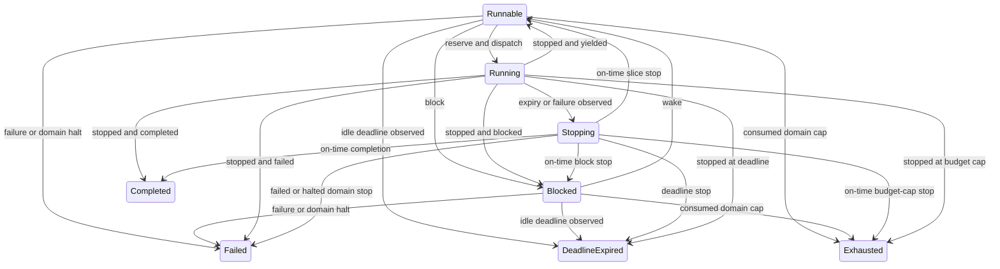

# K03 scheduler and CPU-budget core preparation

Status: standalone policy implementation and host verification preparation.
Native SMP qualification remains pending. This work leaves
[K03](https://github.com/AG187-Lab/tessryn/issues/6) open and dependent on
[K02](https://github.com/AG187-Lab/tessryn/issues/5).

## Ownership boundary

This preparation uses new `scheduler-core/`, K03 tooling/tests/workflow and
dedicated documents/evidence. The kernel session owns K02/native integration;
the K01, infrastructure, AWS and public progress/research lanes retain their
existing files. This PR changes no kernel entry code, memory ownership code,
native ABI, shared documentation indexes or K01/K02 workflows.

## Trusted inputs and identities

`Scheduler<D,T,C>` has fixed tables, each bounded to 1–4096 entries. Public
mutations require exclusive `&mut` access. A future native adapter must establish
caller identity from an authenticated execution context, serialize cross-CPU
mutations and supply consistent node-local monotonic nanoseconds. A descriptor's
task/domain/budget number is not authority. Timestamps from different hosts or
unsynchronized CPU clocks cannot be compared.

Internal `TaskId` and `CpuLease` values are generation-checked policy identities,
not additions to the native wire ABI. They apply to one policy instance; the
native adapter must fence instance/boot epochs rather than transporting these
values as authenticated handles. Domain IDs never recycle within that instance.
Task creation and CPU dispatch advance generations without wrapping; a slot at
the final generation retires after its last occupant is released.

## Admission and accounting

Domain and task CPU limits are immutable lifetime caps. Task ceilings may
collectively exceed the domain cap, but each task ceiling must fit that original
cap. Task creation reserves no runtime; every dispatch reserves its grant from
both ledgers. The positive grant is the minimum of the requested quantum, both
available budgets and the remaining deadline interval. The stop timestamp uses
checked addition. A zero available domain budget due to retained peer grants is
temporary admission denial, rather than permanent task exhaustion.

Before ordinary dispatch, `consumed + reserved + grant <= limit` holds for the
task and domain. A task runs on at most one numerical CPU, and each CPU owns at
most one execution lease. Domain-then-task round-robin prevents adding tasks from
buying additional domain turns while competing domains have eligible tasks.
It supplies no weighted service, latency or throughput guarantee. Selection and
expiry use bounded table scans; no global production scheduling hot path is
mandated by this reference policy.

A trusted stop releases that exact grant and adds the entire observed interval
to task and domain consumption. Overlapping intervals on two CPUs count twice
as aggregate CPU time. Counters use `u128` and checked addition, so totals can
exceed a `u64` budget without wrapping. Reaping a task never refunds the domain's
consumed time; there is no refill/reset API.

An overdue retained lease halts its domain as soon as a successful operation
observes `now > stop_by`. Dispatch/create/wake/block preflight the same lateness
without publishing a rejected mutation. Halt is sticky. Other active contexts
in that domain request stopping while keeping their leases and reservations.
Each still needs a separate trusted stop and full charge. Actual consumption
may exceed a cap after an enforcement overrun. Arithmetic availability saturates
to zero when consumption plus reservations reaches the cap; even if arithmetic
headroom remains, the halted domain cannot admit further work. Unrelated domains remain
eligible unless their own leases are also overdue.

The interval is numerical elapsed time for the assigned execution context,
including service/interrupt overhead under the adapter's declared accounting
rule. Host-supplied timestamps establish no hardware timing accuracy. The native
adapter must qualify clock synchronization, actual start/stop observations,
timer delivery, interrupt latency and any bounded enforcement overshoot.

## Lifecycle and rejection rules

Zero deadline means absent. Nonzero expiry is inclusive: `now >= deadline`
denies new execution. Polling expiry or requesting failure never implies that a
CPU stopped. `Stopping` retains CPU ownership until acknowledgment; blocking,
waking, reaping and redispatch cannot bypass it.

Stop outcome precedence is failure/domain halt, deadline expiry, explicit
completion, consumed-budget exhaustion, then block/yield. Thus completion at
the exact budget cap succeeds, while completion at the deadline expires.
Terminal stopped tasks can be reaped; running/stopping tasks cannot.

Every rejection preserves the entire policy, including clock and round-robin
cursors. Checks cover foreign/stale identities, reused leases, invalid CPUs,
zero grants, capacity, retired generations, backwards time and arithmetic.
Successful operations refresh expiry; read-only queries report the last
committed policy state and do not advance time.

## Evidence and remaining native gate

[The core README](../scheduler-core/README.md) gives exact reproduction commands.
The checker binds all Rust modules and the executed Python/setup/CI dependency
closure, compiler/library identities, source revision and checkout state. It
executes the same original Rust policy on the host and requires identical
repeated freestanding artifacts. Tests use actual policy calls with numerical
CPU interleavings, expected ledgers and complete rejection snapshots.

These are host policy tests, rather than actual cross-core execution or native
timing measurements. K03 acceptance still requires protected isolated tasks on
multiple CPUs after K02, qualified monotonic clocks, timer-driven preemption,
native synchronization, scheduler timelines/cross-core raw traces and measured
accounting under contention. Scheduler expiry/failure does not establish memory
reclamation, output fencing or stopped DMA. CPU budgets imply no universal GPU
preemption or memory-bandwidth isolation.
